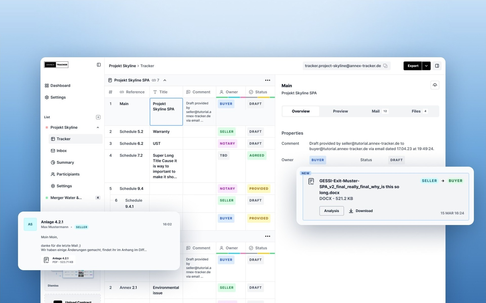
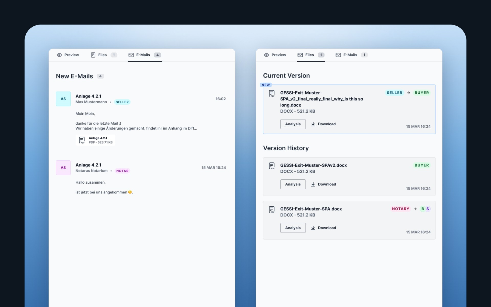
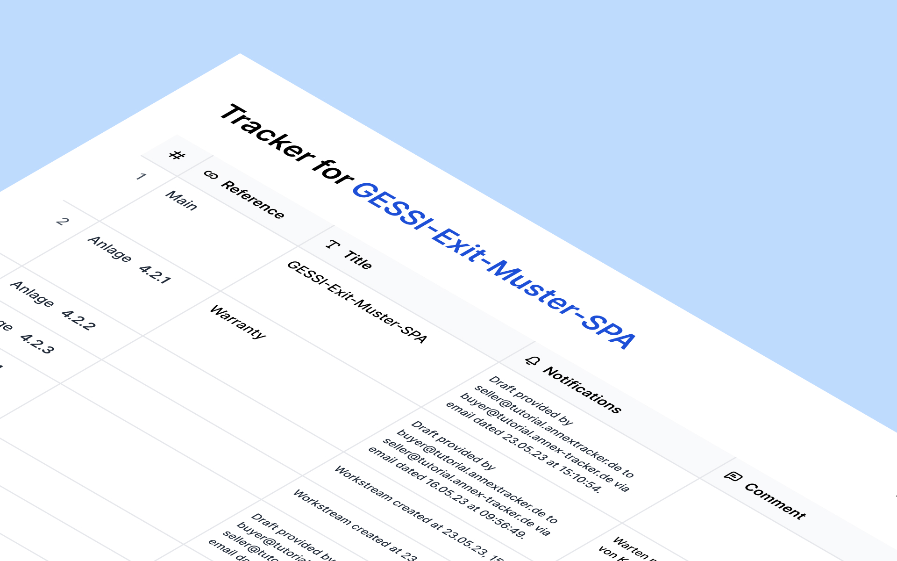

# Annex Tracker

- Product design
- UX research
- Prototyping
- Design system

Product design for a legal tech tool that helps M&A teams create and keep track of annex lists.



A share purchase agreement comes with a long list of annexes. Each one goes back and forth between buyer, seller and notary until everyone agrees on it. Annex Tracker keeps that list, and who has which annex, in one place.

I was the only designer on the team at LITERACY in Stuttgart, as a working student from October 2022 to August 2023. I did the research, the user flows, the prototypes and the design system. The screens here are from that design phase.

## From a list to a tracker

I started by looking at competing tools and at the annex lists lawyers already kept, then used early prototypes to try out the flow.

The product started as a plain list. In the redesign every annex has an owner and a status, annexes are grouped under the document they belong to, and the selected one opens in a panel next to the list.

```compare
before: ./before.jpg
after: ./after.jpg
alt: The Annex Tracker list before the redesign, a plain table of annexes, and after it, a tracker with owners, statuses and a details panel
beforeLabel: Before
afterLabel: Redesign
caption: The same list, before and after the redesign.
```

## Mail and files

Most of the work on an annex happens over email. Each tracker has its own email address, and the mail about an annex shows up next to it, together with its files. Every version of a file is marked with who sent it to whom.



_An annex's mail and files, side by side._

## Beyond the interface

PDF exports were a major part of the work. Clients needed readable documents in their own branding, so I designed the exported lists alongside summary pages and comparisons between versions.



Alongside the product screens, I built a Figma design system for high-fidelity prototypes. A restrained visual style kept the focus on dense tables, document details, and status information.
