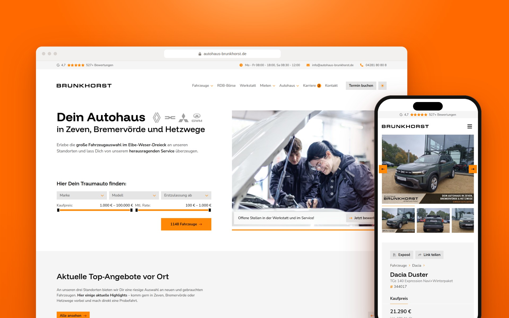
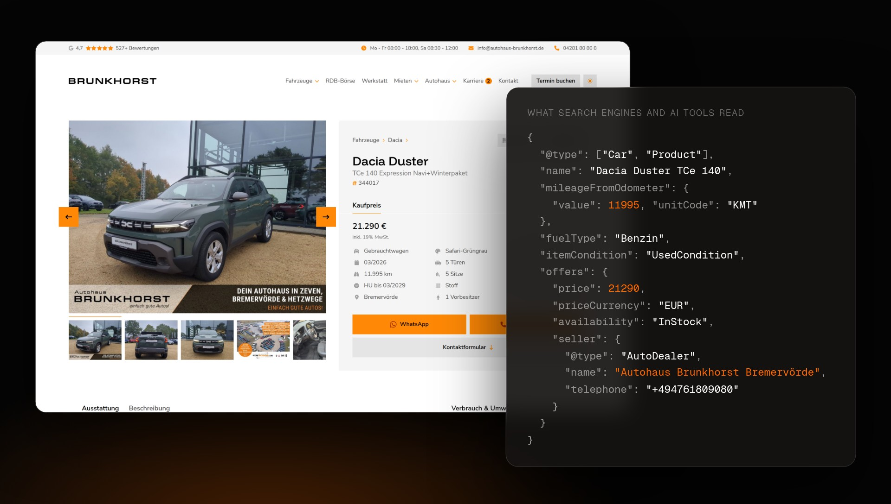

# Autohaus Brunkhorst

- Performance
- CMS migration
- AI readiness
- Agent-friendly codebase

Faster pages, and a car inventory that search engines and AI agents can read, for a dealership with three branches in northern Germany.



Autohaus Brunkhorst sells and services cars in Zeven, Bremervörde and Hetzwege, with around 1,200 cars in stock. More and more people find a car through a search engine or an AI tool before they ever open the website.

In 2026, with lw.works, I made the site faster and cheaper to run, made the inventory readable for the tools people now search with, and set the code up so coding agents can change it safely.

```stats
items:
  - value: 100
    label: Lighthouse performance on desktop, on all five pages tested
  - value: 85 s
    label: per Vercel deploy, from 100–245 s
  - value: 22–33%
    label: smaller pages, with the logo in its own file
  - value: 1.5 s
    label: to check formatting, types and lint. A type check alone took 8 s before
```

## Out of the CMS

The site's copy lived in Payload CMS. I moved all of it into the repository, as pages and Markdown files, and removed the CMS. Scheduled entries like job ads and events still go live on their own, without a deploy. The car inventory still comes live from the dealership's inventory system.

Visitors see the same text on all 51 pages I compared, apart from a few fixes to copy that had drifted apart in the CMS. And the pages got faster:

```chart
title: Lighthouse performance
series: [With Payload, Content in the repo]
rows:
  - label: Mobile
    values: [[56, 78], [81, 88]]
  - label: Desktop
    values: [[87, 99], [100, 100]]
caption: Each bar spans five pages, at the median of three runs each.
```

A Vercel deploy went from 100–245 seconds to 85.

One fix stood out. Next.js drew each image's blur placeholder on a small canvas and stretched it to the image's size, which cost about 1.5 seconds of rendering on full-width images. Drawn at the image's own size, it costs about 0.1 seconds.

The sitemap now lists all of the cars instead of the first 500, the most the inventory system returns per request.

## Less work per visit

After these changes, almost every page view re-rendered and stored a whole page, and the cost of those writes went from $0.17 to $0.56 a day. Most pages change only with a deploy, so they now re-render every six hours. Pages with scheduled entries stay at one hour. The logo moved from inline markup into one file, which makes pages 22–33% smaller.

The inventory client cast the system's answers to `any`, and turned every failure into an empty result. A hiccup sent visitors of an available car to "not found", and the car index missed over half the stock. Now every answer is checked against a schema, and errors are typed: a car that's gone is a 404, an outage is not. Featured cars and the car index are cached for three hours, searches are cached in the browser and at the edge, and a deploy no longer calls the inventory system about 500 times.

## Readable for search engines and AI

Car pages had a title and not much else. Now each one describes the car as structured data: price, mileage, condition, and the branch it's at, with that branch's address and phone number. Its meta description is written from the same data. The company and the branches say which region they serve.



_Google's Rich Results Test finds product snippets, breadcrumbs, local business and organization, all valid._

Google retired its vehicle listing results in 2025, so each car is also typed as a product, which keeps price and stock eligible to show in search results.

`/llms.txt` sums up the dealership for language models: the branches, rentals, offers, jobs and upcoming events, generated from the same data as the pages. It says the dealership is local and everything happens on site, and points to the sitemap for the cars.

## A search tool for browser agents

AI agents that browse for someone, like Gemini in Chrome or the ChatGPT desktop browser, could only use the car search by clicking through it. Brands and models sit behind custom dropdowns.

Now the site gives them a WebMCP tool, `search_cars`. The agent asks in plain words and gets the matches back as data.


_A test run: 19 matches, the same 19 the search page shows._

The tool uses the endpoints the search page already uses, so an agent's search costs what a visitor's search costs. It returns four cars at most, which keeps the answer within what Chrome passes on to the agent. If a name doesn't match, the error lists the valid ones, so the agent can try again. Browsers without WebMCP skip the tool.

## Built to be edited by agents

The site is edited through coding agents, so I set the repository up for them:

- A guide for agents: what each part is called, what can do real damage (live forms, production, copy), and how to check a change.
- One command sets up a fresh worktree, and outside production the forms only log what they would send, so they never reach a real inbox.
- One check for formatting, types and lint, which ran in about 1.5 seconds. It runs before every build, so every Vercel build is also the CI.
- Strict types, including the Markdown frontmatter and every internal link, so a typo fails the check instead of showing up as a 404.
- End-to-end tests for what the site exists for: asking about a car, applying for a job and requesting a rental car. All three run in 41 seconds.

Most changes were also reviewed by a second model before they went in.
