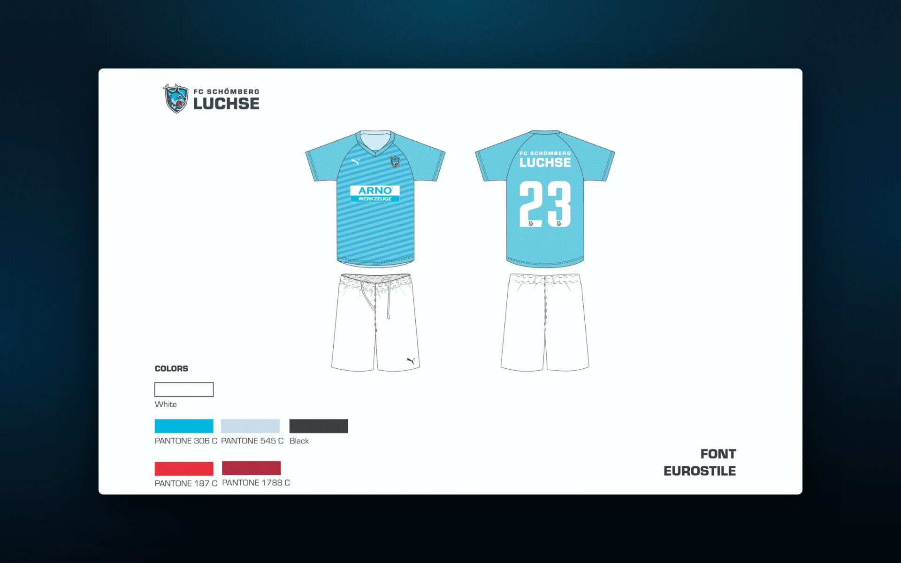
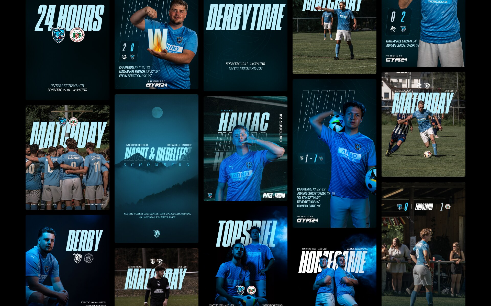

# FC Schömberg Luchse

- Visual identity
- Crest & wordmark
- Kit & merchandise
- Social media

The whole look of a football club I founded with friends: crest, wordmark, kit, scarf and every matchday post.

In 2023 a group of friends and I founded FC Schömberg Luchse e.V., a football club in the northern Black Forest. I was on the board, and I designed everything the club put its name on.

There was no brand to start from. I began with the animal in the name (Luchse means lynxes) and built the rest around it.

## The crest

The lynx started as a hand sketch. I redrew it as a vector mark that breaks out of a shield, and set the name in Eurostile, wide and heavy. Where the full name doesn't fit, a short FCSL version does.

Four colours run through all of it: a bright light blue, a deeper blue, a pale grey-blue and a near-black called Night.

## Kit and scarf

The shirt is light blue with diagonal stripes in a lighter tone, the crest on the chest and the name and number in Eurostile on the back. I drew it up as a print guide, with a Pantone reference for every colour.

The scarf spells LUCHSE in outlined letters, with the lynx breaking through them, and splits the founding year across its two ends.

## Matchday

Most of what a club puts out happens on Instagram, every week. I made a set of templates in Figma for each kind of post: the fixture list, matchday, the starting eleven, results, player of the month and new partners. Condensed italic headlines, the players in the light blue kit, the crest next to the opponent's badge.

The same look carried over to a sponsorship deck, posters and business cards.

## Today

The club still plays. I've since stepped back, and someone else makes its graphics now.
