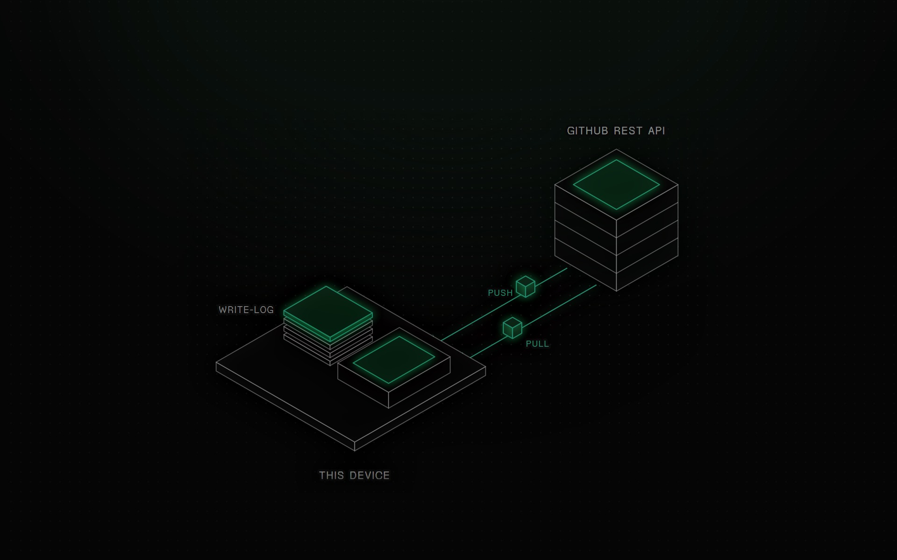

# Local-first API sync

- Research
- Sync architecture
- Local First

My bachelor thesis: a sync layer that lets local-first apps work with data from external APIs, in both directions.



Local-first apps open instantly and work offline, until they need data from someone else's API. I designed an algorithm that syncs them with APIs like GitHub's, built it into an issue tracker, and benchmarked it against a client-server version of the same app.

My bachelor thesis, completed in June 2025 at [Hochschule der Medien, Stuttgart](https://hdm-stuttgart.de/).

## Local-first stops at someone else's API

The idea came up in December 2024, in a bar in Berlin after the Local-First Meetup, talking with [Johannes Schickling](https://x.com/schickling) about exactly this. He'd run into it building [Overtone](https://overtone.pro), his local-first music app: how do you keep it in sync with Spotify or SoundCloud? We worked the idea out together, and in the end, he liked my approach.

Local-first apps keep their data on the device, so they open instantly and keep working offline. But many apps also show data from other services: playlists from Spotify, issues from GitHub. Calling those APIs directly takes that away again: the app waits for the network, and stops working offline.

And those APIs weren't built for it. They return a snapshot of each item, don't merge conflicting changes, and don't say when something changed. Sync engines like [ElectricSQL](https://electric-sql.com) or [Zero](https://zero.rocicorp.dev) need access to the server's database, which you don't get for someone else's API.

When I wrote the thesis, no paper covered this problem. I found two on related ones, both about caching in cloud apps.

## Where it had to fit

Two more constraints. The app should stay truly local-first, without a server of its own. And many local-first apps already have a sync engine that keeps their own devices in sync, so this sync shouldn't get in its way.

So it sits wherever the app's own sync engine sits, on top of the app's database. That can be the client, as long as the API key can be stored securely there: I left security and cryptography out of scope and assumed it. Or it runs on a server, for apps that sync through one, like [ElectricSQL](https://electric-sql.com), [Zero](https://zero.rocicorp.dev) or [LiveStore](https://livestore.dev).

## Goals

The first three are ideals from the essay that named local-first software,[^ideals] the other four keep the sync itself cheap.

```cards
items:
  - title: No spinners
    icon: pixelZap
    text: Respond in under 100 ms. Below that, people feel they're working the interface directly. Up to a second they notice the wait, and beyond that it breaks their flow.
    wide: true
  - title: The network is optional
    icon: pixelOffline
    text: All reads work offline, and every write the API doesn't have to approve.
  - title: The Long Now
    icon: pixelHourglass
    text: If the API goes away for good, the app keeps working with the last data it sent.
  - title: Read your own writes
    icon: pixelEye
    text: Every edit shows right away, before it's synced.
  - title: Few requests
    icon: pixelRequests
    text: APIs limit or bill them, and every sync takes time from the app on JavaScript's single thread.
  - title: Little storage
    icon: pixelArchive
    text: Browsers cap what a site may store; Firefox at 10% of the disk.
  - title: No slowdown
    icon: pixelSpeed
    text: The app stays as fast while it syncs.
    wide: true
```

## An algorithm over a write-log

Every write to a synced table is logged in the same transaction as the write itself, so no change is saved without being logged. An entry keeps only the fields that changed, before and after:

```json title="A write-log entry"
{
  "number": 1,
  "object_id": 1,
  "object_table": "issues",
  "method": "update",
  "old_data": { "title": "Old Title" },
  "new_data": { "title": "New Title" }
}
```

Each table syncs on its own interval. A sync run pulls the items changed since the last sync and sorts every changed item into a category, in two passes. The first goes through what the API returned: an item that doesn't exist locally is new, one without entries in the log was only changed remotely, and one with entries was changed on both sides, a conflict. The second goes through the log for the rest: items created, updated or deleted only locally.

```sync-steps
id: merge
```

A conflict needs the fields the API changed, but the API sends the whole item. Keeping a copy of every item as it was at the last sync would cost storage. The log already has it: undoing its entries gives the item at the last sync ([step 4](step:merge/4)), and comparing that with the API's copy leaves only what changed there ([step 5](step:merge/5)).

Those changes are applied after the local ones, so the API wins a field both sides changed, and edits to different fields both survive ([step 6](step:merge/6)). That order fits one person working locally against GitHub, where many people might work; another app can choose another order. The results are pushed through a queue that stays under the API's rate limits and saved locally, and the log is cleared ([step 7](step:merge/7)).

My advisor [André König](https://x.com/ItsAndreKoenig), whom Johannes recommended to me, helped a lot in validating the algorithm.

## One adapter per database

```sync-live

```

The sync doesn't bring a database of its own. It adds a write-log table to the app's database and hooks into the database's own write calls, so every write is logged without the app doing anything. In the prototype, that's a [Dexie.js](https://dexie.org) add-on for IndexedDB, and marking a table as synced is one line:

```ts nocheck title="db.ts"
db.version(1).stores(
  { issues: "++id, github_number, user", projects: "++id" },
  { sync: ["issues"] },
);
```

So the developer builds the app like any local-first app, against their own database, and never calls the API. What they do write is the mapping between the two sides: GitHub's `body` is the app's `description`, and GitHub's open or closed becomes one of four statuses. They still control the sync: how often each table syncs, whether it's read-only or only syncs when asked, and when it last ran.

Another database needs another database adapter, and another API another API adapter.

## Results

I benchmarked the prototype against a client-server version of the same app, built with SvelteKit's server-side rendering, in Chrome with Playwright.

The client-server version has none of the usual tricks on purpose: no optimistic UI, no client-side caching, no partial or deferred loading. Those hide the network instead of removing it, and every app has to build them again. Both apps load all of a project's data at once, so the comparison is like for like. That's also the point: a local-first app doesn't need the tricks. Its data is already on the device, so it can simply load all of it. The device is rarely the bottleneck; the network is.

```stats
items:
  - value: 97%
    label: faster to reopen a project
  - value: <100 ms
    label: from saving an edit to seeing it
  - value: "10"
    label: API requests for 20 edits, not 103
```

Opening a project again took 24 to 36 ms, read straight from the device, against 0.7 to 1.8 seconds for the client-server app: about 97% faster.

```timing
title: Opening a project again
series: [Client-server, Local-first]
marker: { value: 100, label: 100 ms }
rows:
  - label: 10 issues
    values: [689, 23.8]
    issues: 10
  - label: 50 issues
    values: [710, 24.8]
    issues: 50
  - label: 250 issues
    values: [1823, 36.2]
    issues: 250
caption: At real speed, the mean of five runs each.
```

Every edit was on screen in under 100 ms: saved to the database and read back from it, on average 2.6 ms to create an issue and 18 ms to update one. So what you see is the data as it's stored, not an optimistic guess that a request might still overturn. The client-server app took more than 1.3 seconds for both, and the times held while the sync ran in the background.

```timing
title: Seeing your own edit
series: [Client-server, Local-first]
rows:
  - label: Create an issue
    values: [1332, 2.6]
    action: create
  - label: Update an issue
    values: [1358, 17.7]
    action: update
marker: { value: 100, label: 100 ms }
caption: Until the change is on screen, at real speed, the mean of five runs each.
```

It also sends far fewer requests. Editing one issue every 15 seconds for five minutes took 103 requests in the client-server app: each edit is sent on its own, and the whole repository is fetched again after it. The sync batches instead. Each run pulls only what changed and folds all edits to one issue since the last run into a single update, so the same five minutes took 10.

```requests-live

```

After a sync, the layer keeps about 25 bytes per synced item.

Reading, creating and updating issues all work offline, and edits wait in the log until the first sync after the connection comes back. The client-server version failed each of these offline tests, and needed a manual refresh once it was back online.

## Trade-offs

The first load of a project is slower, because every issue is translated and stored: 5.8 seconds for 250 issues, against 1.5 seconds. It only happens once per project.

Data is as fresh as the last sync. The interval trades freshness for fewer requests, but not responsiveness: edits are instant at any interval.

Some things are still open. The write-log can grow without limit if the API stays unreachable. A sync interrupted halfway starts over and could send the same writes again. Thousands of edits queued offline would run into GitHub's rate limits. And the layer was built for a single user, and tested with tens of issues on a fast desktop and connection.

The prototype used [SvelteKit](https://svelte.dev/docs/kit), Dexie.js and [TinyTick](https://tinytick.org), with adapters for IndexedDB and GitHub's REST API. It's a research prototype, not a production-ready sync library.

Thanks to my professor for distributed systems, [Prof. Dr. Tobias Jordine](https://hdm-stuttgart.de/person/jordine/), for letting me research a topic this new.

```paper
href: /projects/local-first-api-sync/thesis.pdf
page: ./title-page.svg
title: Implementation of a synchronization layer for external APIs in local-first applications
pages: 82
```

[^ideals]: Martin Kleppmann, Adam Wiggins, Peter van Hardenberg and Mark McGranaghan, [Local-first software: you own your data, in spite of the cloud](https://www.inkandswitch.com/local-first/), Ink & Switch, 2019. It names seven ideals; these are its first, third and fifth.
