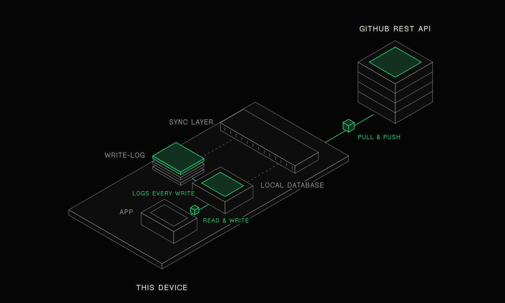

# Local-first API sync

- Research
- Sync architecture
- Prototype
- Benchmarks

My bachelor thesis: a sync layer in the browser that lets an app built on someone else's REST API work local-first, without changing the server.


Local-first apps keep their data on the device, so they open instantly and keep working offline. The sync engines behind them usually need a server of their own. Many apps don't have one: they're built on a third-party REST API, and most of those can't resolve conflicts or push updates.

I designed a synchronization layer that runs entirely in the client, built it into a GitHub issue tracker, and benchmarked it against a client-server version of the same app. Completed in June 2025 at Hochschule der Medien, Stuttgart.

## What a sync engine expects

```sync-steps
id: engine
```

Local-first sync engines like ElectricSQL or Zero need access to the server's database. With that, sync can work like this: a change is saved on the device ([step 1](step:engine/1)), sent to the server ([step 2](step:engine/2)), merged there ([step 3](step:engine/3)), and pulled by the other devices ([step 4](step:engine/4)).

Step 3 is the problem. GitHub's REST API doesn't merge anything: it stores what it's sent. It also only answers when asked. A request for the issues changed since a timestamp returns each issue whole, not what changed. So the merge has to happen on the device, before anything is sent.

## A sync layer on the device



_The app only talks to its local database. The sync layer does the rest._

The app reads and writes a local IndexedDB database through Dexie.js, and never calls the API. For synced tables, a Dexie add-on I wrote logs every write to a write-log, in the same transaction as the write itself, so no change is saved without being logged. An entry keeps only the fields that changed, before and after:

```json title="A write-log entry"
{
  "number": 1,
  "object_id": 1,
  "object_table": "issues",
  "method": "update",
  "old_data": { "title": "Old Title" },
  "new_data": { "title": "New Title" }
}
```

Each table syncs on its own interval: issues every 60 seconds in the prototype, repositories only when asked, read-only. A run pulls the items changed since the last sync, works out what changed where, pushes the local changes through a queue that stays under GitHub's rate limits, and then clears the write-log. While the device is offline, syncing pauses.

The two sides don't share a schema. For each table, the app gives the layer a pair of functions that translate between them: GitHub's `body` is the app's `description`, and GitHub's open or closed becomes one of four statuses in the app. Everything specific to GitHub lives in an adapter, so another REST API only needs a new adapter.

## Sorting every change in two passes

Each sync sorts every changed item into one category. The first pass goes through what the API returned: an issue that doesn't exist locally is new, one without local edits was only changed on GitHub, and one with entries in the write-log was changed on both sides, a conflict. The second pass goes through the write-log for the rest: issues created, updated or deleted only on the device. (The design covers deletes; the prototype didn't need them.)

For a conflict, the layer needs to know which fields GitHub changed, but GitHub sends the whole issue. Keeping a copy of every issue as it was at the last sync would cost storage. The write-log already has what's needed: every entry keeps the old values, so undoing the log gives the issue as it was at the last sync. Comparing that with GitHub's copy leaves only the fields GitHub changed.


_The title changed on GitHub, the description on the device. Both edits survive._

GitHub's changes are applied after the local ones, so GitHub wins a field both sides changed, and edits to different fields are merged. That order fits this app: one person works locally, while many people might work on GitHub, and their changes shouldn't be overwritten. Another app could choose a different order.

## Offline

```sync-live

```

Reading, creating and updating issues all work offline, and new edits show up right away. They wait in the write-log, and the first sync after the connection comes back sends them, without anyone pressing anything. To everyone else on GitHub, an edit made offline simply arrives a bit later.

The client-server version failed each of these offline tests, and needed a manual refresh once it was back online. One limit: the prototype had no service worker, so it had to be loaded online once. That's the app's job, not the sync layer's.

## Results

I benchmarked the prototype against a client-server version of the same app, built with SvelteKit's server-side rendering and no client-side caching, in Chrome with Playwright.

```stats
items:
  - value: 97%
    label: faster to open a project again
  - value: <100 ms
    label: until an edit is on screen, offline too
  - value: "10"
    label: API requests for 20 edits to one issue, against 103
```

Opening a project again took 24 to 36 ms, read straight from the device, against 0.7 to 1.8 seconds for the client-server app: about 97% faster.

```chart
title: Opening a project again
series: [Client-server baseline, Local-first prototype]
unit: ms
rows:
  - label: 10 issues
    values: [689, 23.8]
  - label: 50 issues
    values: [710, 24.8]
  - label: 250 issues
    values: [1823, 36.2]
caption: The mean of five runs each.
```

Every edit was on screen in under 100 ms, on average 2.6 ms to create an issue and 18 ms to update one. The client-server app took more than 1.3 seconds for both. That held while the layer was syncing in the background.

```chart
title: Seeing your own edit
series: [Client-server baseline, Local-first prototype]
unit: ms
rows:
  - label: Create an issue
    values: [1332, 2.6]
  - label: Update an issue
    values: [1358, 17.7]
marker: { value: 100, label: 100 ms }
caption: Time until the change is on screen, the mean of five runs each.
```

It also sends fewer requests, since it only fetches issues that changed and folds repeated edits to one issue into a single update. Updating one issue 20 times in five minutes took 10 API requests with a 60-second interval, against 103 for the client-server app. After a sync, the layer keeps about 25 bytes per synced item.

## Trade-offs

The first load of a project is slower, because every issue is translated and stored: 5.8 seconds for 250 issues, against 1.5 seconds. It only happens once per project.

Data is as fresh as the last sync. The interval trades freshness for fewer requests, but not responsiveness: edits are instant at any interval.

Some things are still open. The write-log can grow without limit if the API stays unreachable. A sync interrupted halfway starts over and could send the same writes again. Thousands of edits queued offline would run into GitHub's rate limits. And the layer was built for a single user, and tested with tens of issues on a fast desktop and connection.

The prototype used SvelteKit, Dexie.js and TinyTick, with an adapter for GitHub's REST API. It's a research prototype, not a production-ready sync library.

[Read the full thesis (PDF)](/projects/local-first-api-sync/thesis.pdf)
