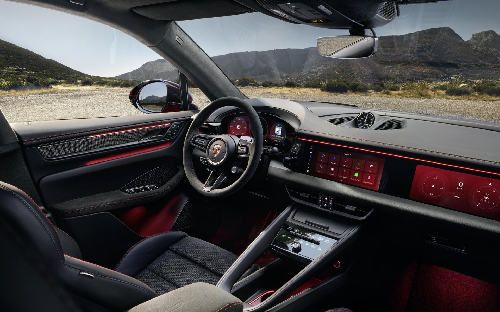
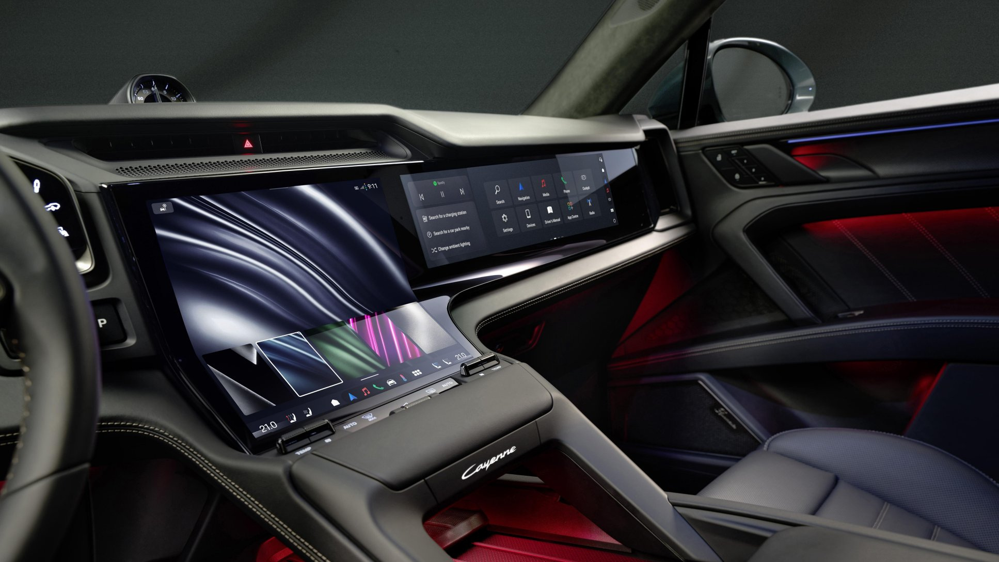

# Porsche Driver Experience

- UX design
- Automotive HMI
- Design systems
- Design tooling

Infotainment design for the Porsche Macan and Cayenne, and the tools that helped the team design faster.



From August 2023 to March 2025 I worked in Porsche's Driver Experience team in Weissach, first as an intern, then as a working student.

I worked on the interface of the Macan and the new Cayenne, built a design system for the next generation of Apple CarPlay, and changed how the team presented and built its designs.

## One dock

I was on a small team that reworked the Macan's interface concept.

The screen had two status areas: a dock on the left, and the time and status on the right. I merged them into one dock on the left. On a small screen, every bit of usable space counts.

The dock also floats, so the map can become the background and run behind it.

```compare
before: ./dock-before.jpg
after: ./dock-after.jpg
alt: "A diagram of the screen layout. Before: a dock on the left and a time and status column on the right frame the map. After: one floating dock holds apps, time and status, and the map fills the screen behind it."
beforeLabel: Two status areas
afterLabel: One dock
caption: The layout as a diagram. Drag to compare.
```

## Light and theme

I introduced a theming system that connects the interior's ambient light with the background of the interface, so the screens and the cabin share one color.

```video
src: ./theme.mp4
poster: ./theme.jpg
alt: A driver picks a theme on the Macan's central display, and the ambient light along the dashboard changes with it, from red to orange to green.
caption: Picking a theme changes the cabin light with it.
```

## Drive and navigation

I helped modernize the Drive screen and the navigation. The Drive screen brings driving modes and vehicle settings together, next to a view of the car.

```video
src: ./drive.mp4
poster: ./drive.jpg
alt: A driver opens the Drive screen on the Macan's central display and picks a drive mode from a list next to a 3D view of the car.
caption: The Macan's Drive screen.
```

I also reworked how development worked with UX inside Porsche. We designed quicker and turned work around much faster, so the concept could land before production.

## Cayenne

Afterwards I carried what we learned into newer cars. In the new Cayenne I helped on the Drive and Charge screens and on the widgets.



## CarPlay

For the next generation of Apple CarPlay in Porsche, I built the team's internal design system and component library.

Apple only provided screenshots, so I rebuilt Apple's design system. With it, the team could iterate quickly and judge whether Apple's design was good enough, and how it would fit and feel in Porsche's system.

## Faster design

I ran several Figma workshops to help colleagues build faster.

Presentations used to be made in PowerPoint. I built a system to present straight from Figma: it uses the right components automatically and stays up to date with the designs. That cut a lot of work from every presentation.

_Interior photos and videos courtesy of Porsche, from official press material._
