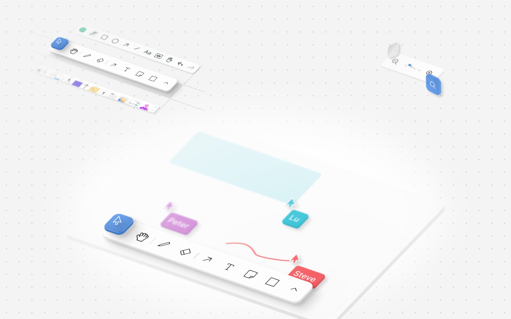
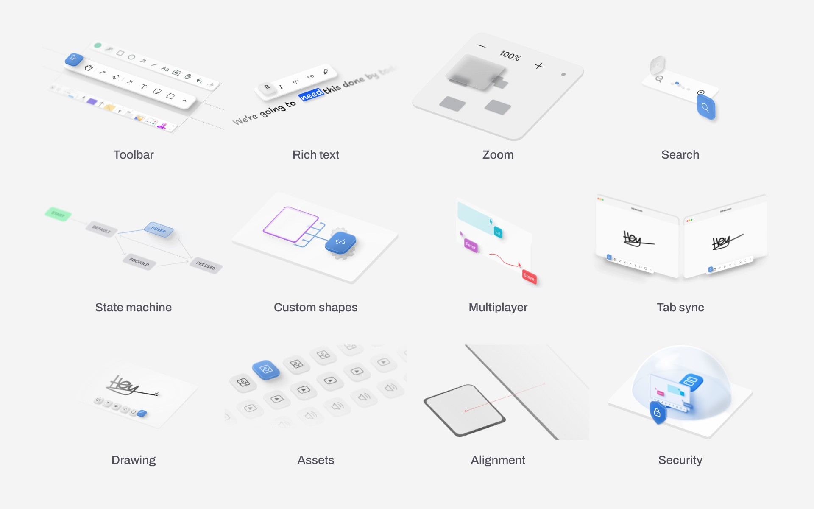
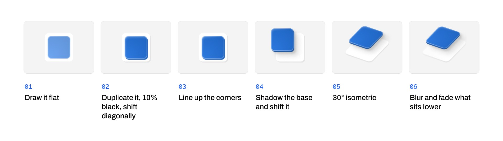
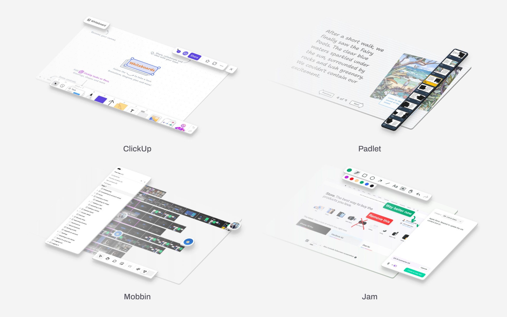

# tldraw

- Web design
- Design system
- 3D illustration

A website, its design system and a kit of soft 3D illustrations for tldraw, the infinite canvas SDK for React.

tldraw is an SDK for building whiteboards, diagrams and other canvas apps in React. Teams like ClickUp, Padlet and Mobbin build their products on it.

I worked on [tldraw.dev](https://tldraw.dev/) as part of the [lw.works](https://lw.works/) team, from September to December 2025. I designed the website and its design system, and made the 3D visuals that show what the SDK can do.

## The website

The site explains a developer tool to developers: what the SDK does, how to start, and who already uses it. I designed the homepage, pricing, the FAQ, the starter kits and the feature pages, from the whiteboard to multiplayer and accessibility.

Each page opens the same way: a short headline, one line on what you get, and `npm create tldraw` ready to copy. On the homepage, the SDK itself comes right after: a live canvas next to the code that makes it.

## A small design system

The website was meant to stay minimal, so the system is small. One typeface, Archivo, in three weights, with Geist Mono for code. One blue for actions and links, and four neutrals for text, borders and backgrounds. Glass versions of the grey and the blue, with a matching blur, cover the rest.

_Every card follows one border rule: a sunken outer edge with a 10px radius, and the content 4px inside it with a 6px radius._

Sizes are set in rem from a 14px base, so the whole scale moves together when a page needs larger type.

## 3D visuals from a kit of parts

Every feature page needed a picture of its feature. Instead of drawing each one from scratch, I built a library of parts in Figma: toolbars, cursors, buttons, panels and canvases. A new visual is a few parts clicked together into a scene.

No 3D software is involved. Each part is drawn flat, given depth with a darker duplicate and a shadow, then set at a 30° isometric angle with a plugin. The soft look comes last: parts that sit lower fade to 70% opacity and blur a little, like a macro photo with a shallow focus.

_The six steps, as written down in the Figma file next to the parts._

Because every visual uses the same parts and the same steps, they read as one set. The kit grew to cover the starter kits, from multiplayer and chat to an AI agent, and the industry pages.

## Customer stories

The showcase uses the same parts: each customer's product, redrawn as a scene on a tldraw canvas.

