# tldraw

- Web design
- Design system
- 3D illustration

A website, its design system and a kit of soft 3D illustrations for tldraw, the infinite canvas SDK for React.


tldraw is an SDK for building whiteboards, diagrams and other canvas apps in React. Teams like ClickUp, Padlet and Mobbin build their products on it.

I worked on [tldraw.dev](https://tldraw.dev/) as part of the [lw.works](https://lw.works/) team, from September to December 2025. I designed the website and its design system, and made the 3D visuals that show what the SDK can do.

## The brief

tldraw wanted the site to be very plain: one typeface with only a few type styles, black and white with a single accent colour, and few borders. With that little to work with, every choice shows. We built the site in Framer, a tool I hadn't used before.

So we started with the design system, before any page.

## A small design system

The typeface is Archivo. Its geometric shapes fit the brief, and it stays plain at every size. Geist Mono sets the code.

Colour does one job each. Body copy is a dark grey, and black marks what's active or important. Blue is only for actions: on tldraw.com, the free whiteboard the team builds to test its own SDK, blue is the selected tool, so it became the colour of every button and link here. A light grey and white make the backgrounds.

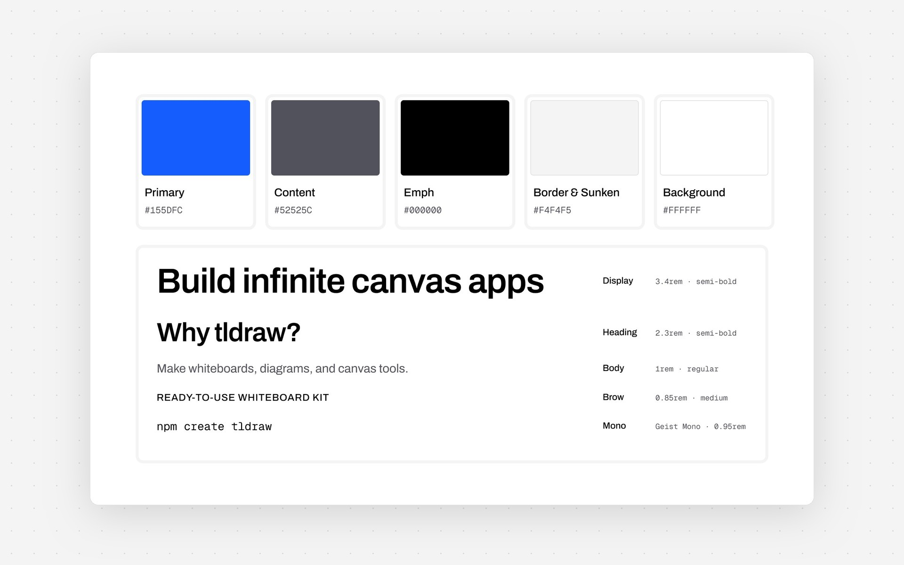

_Every card follows one rule instead of a border: a sunken grey edge with a 10px radius, and the content 4px inside it with a 6px radius._

There are four sizes of type: display, heading, body and a small uppercase brow over each section. They're set in rem from a 14px base, so the whole scale moves together when a page needs larger type.

## The homepage

The old homepage opened on a screenshot of a code editor. The new one opens on the SDK itself: a short headline, `npm create tldraw` ready to copy, and a live canvas next to the code that makes it.

```compare
before: ./home-before.jpg
after: ./home-after.jpg
alt: The top of the tldraw.dev homepage, before with a centred headline under a screenshot of a code editor, after with a left-aligned headline over the code and a live tldraw canvas side by side
beforeLabel: October 2025
afterLabel: Redesign
caption: The top of the homepage, before and after.
```

## Feature pages

Besides the homepage, I designed pricing, the FAQ, the starter kits and a page for each feature, from the whiteboard to multiplayer and accessibility.

The feature pages were long lists: an icon, a title and a sentence, again and again. The lists had to stay, because the number of features is the point: they show how much the SDK can do. So I kept every item and made the pages worth scrolling. The most important features get a large card with a picture of what they do, and the rest sit in smaller cards beside them.

```compare
before: ./feature-before.jpg
after: ./feature-after.jpg
alt: The multiplayer feature page, before as a two-column list of features under a centred headline, after as a grid of cards with 3D pictures of cursors, live updates and synced sessions
beforeLabel: October 2025
afterLabel: Redesign
caption: "The multiplayer page: the same six features, as a list and as cards."
```

Each page opens the same way as the homepage: a short headline, one line on what you get, and `npm create tldraw`.

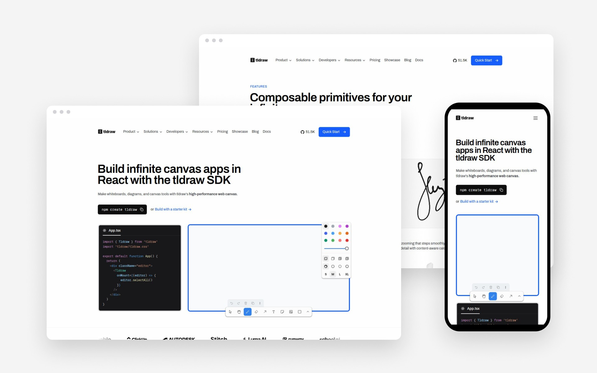

## 3D visuals from a kit of parts

Every feature needed a picture. Instead of drawing each one from scratch, I built a library of parts in Figma: toolbars, cursors, buttons, panels and canvases. A new visual is a few parts clicked together into a scene.

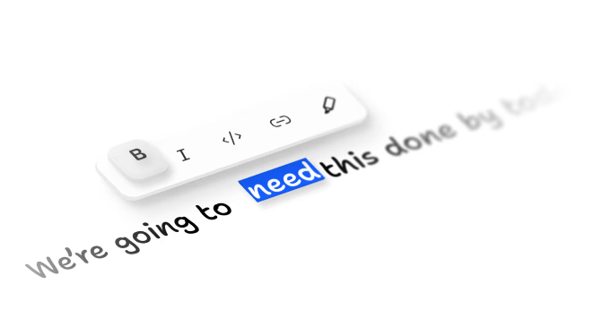
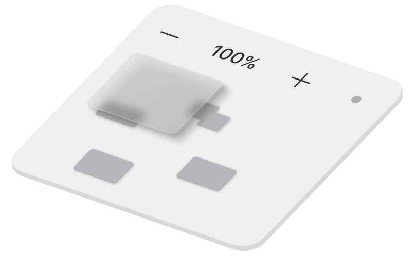
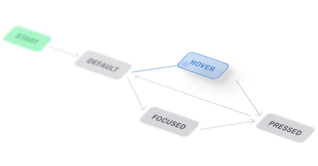
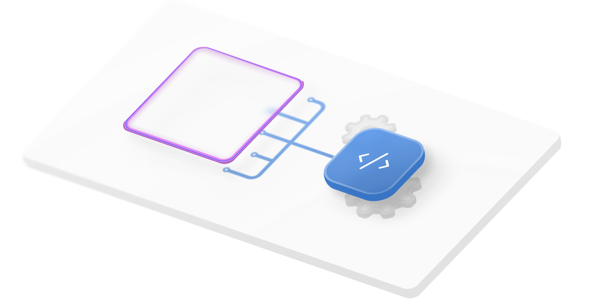
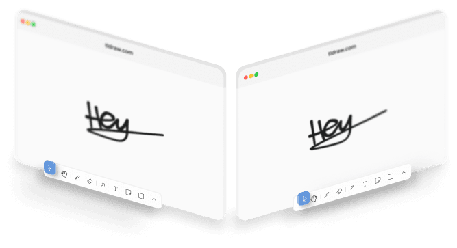
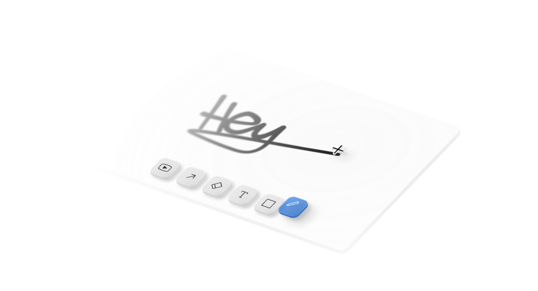
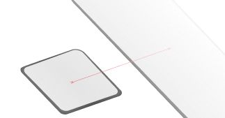
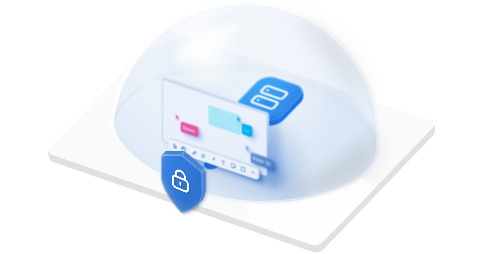

No 3D software is involved. Each part is drawn flat, given depth with a darker duplicate and a shadow, then set at a 30° isometric angle with a plugin. The soft look comes last: parts that sit lower fade to 70% opacity and blur a little, like a macro photo with a shallow focus.

```kit-steps
id: kit
```

Because every visual uses the same parts and the same steps, they read as one set. The kit grew to cover the starter kits, from multiplayer and chat to an AI agent, and the industry pages.

## Customer stories

The showcase uses the same parts: each customer's product, redrawn as a scene on a tldraw canvas.

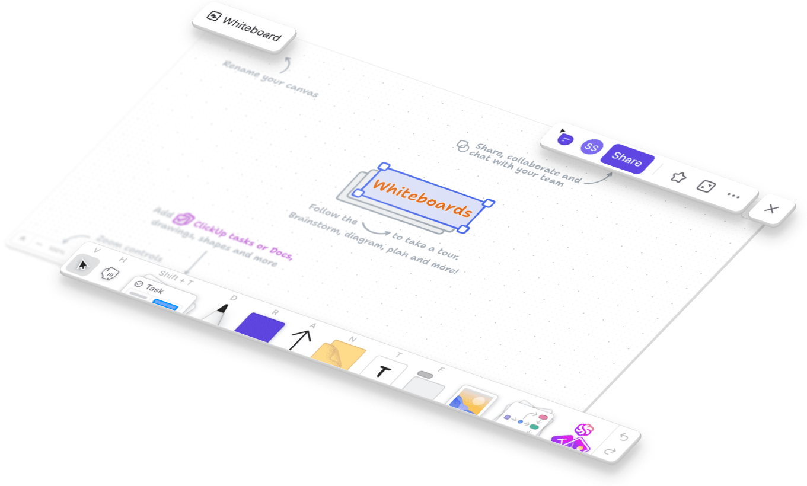
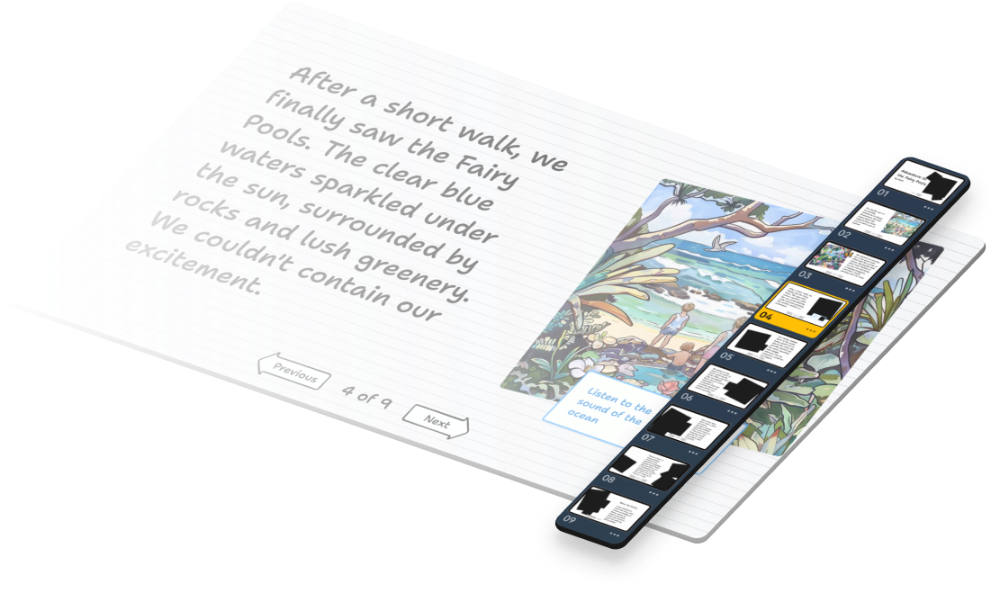
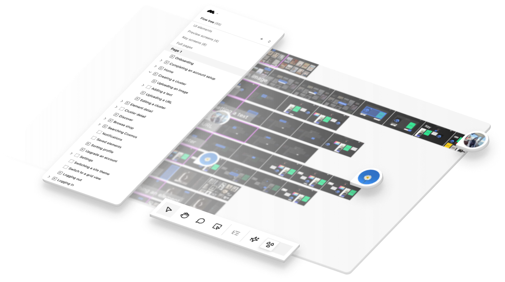
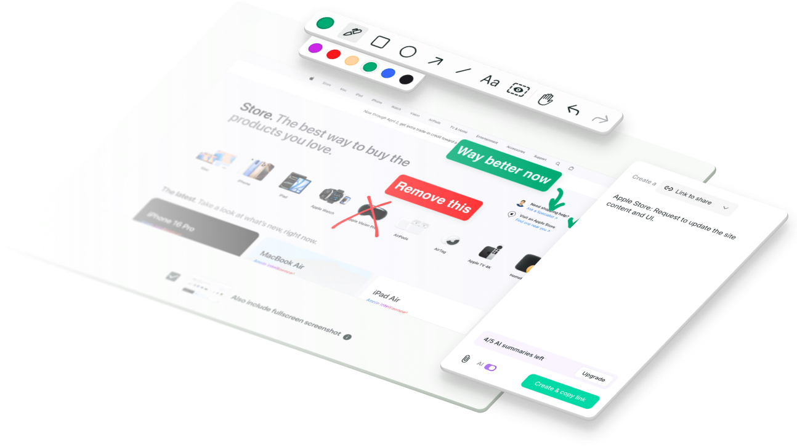
