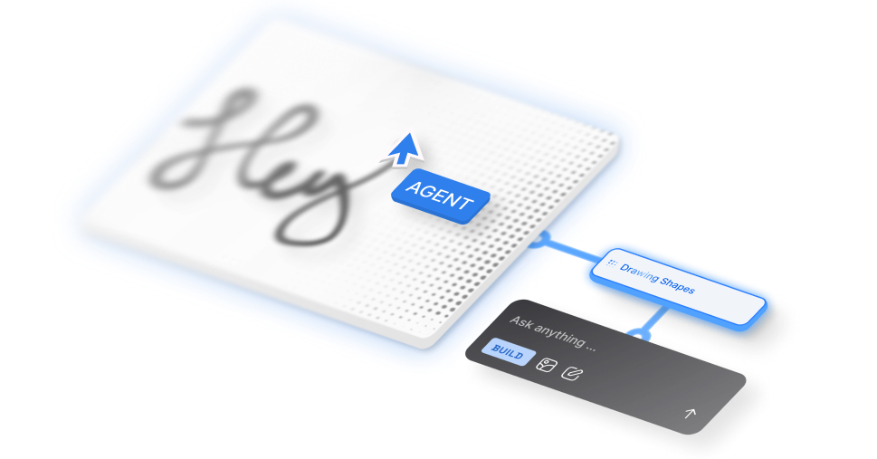
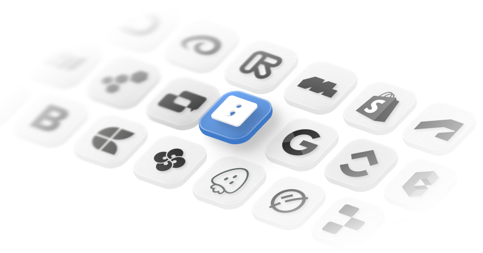

# The writing toolkit

A test piece for every block and inline component the writing can use. It's a seed, so it only shows in development and on preview deployments.

## Notes

> [!NOTE] Depth test
> `delta` here is the signed depth difference between the surface and the ray sample:
>
> - `delta < 0` means the sample is in front of the surface
> - `delta >= 0` means it's at or behind the surface
>
> We count a hit the moment `delta` changes sign.

> [!TIP]
> Sample the depth once per step, not per pixel.

> [!IMPORTANT] Clamp the value
> Without clamping, the plane breaks when seen _through_ a transmissive mesh.

> [!WARNING]
> This only works for opaque surfaces.

> [!CAUTION]
> Not clamping the value caused weird side effects when viewing the plane through `MeshTransmissionMaterial`.

## Code

A plain block, with a file name:

```ts title="review.ts" nocheck
import { OpenCode } from "@opencode/client";

const client = OpenCode.make({ baseUrl: "http://localhost:4096" });
const session = await client.session.create({ location: { directory: process.cwd() } });
await client.session.prompt({ sessionID: session.id, text: "Review the current changes" });
```

One without a title, in another language:

```bash
vp install
vp dev
```

## Shortcuts

Press <kbd>⌘</kbd> <kbd>K</kbd> to search, or <kbd>⌘</kbd> <kbd>⇧</kbd> <kbd>R</kbd> to reload without the cache.

## Links

Models come from [models.dev](https://models.dev), and the site is built with [Svelte](https://svelte.dev): external links open in a new tab. Links to the site's own pieces stay in it: [Your factory is a garden](/writing/factories).

## Footnotes

Local-first software keeps the data on your device first.[^local] Sync is the hard part.[^sync]

[^local]: See [Local-first software](https://www.inkandswitch.com/local-first/) by Ink & Switch.

[^sync]: Mostly because two devices can change the same thing while offline.

## Visualization

```sync-steps
id: sync
```

The local change is made in [step 1](step:sync/1), sent in [step 2](step:sync/2), and merged in [step 3](step:sync/3).

One that plays on its own, in a loop (`loop: false` plays it once):

```sync-live

```

## Images



_Click an image to open it in the gallery._



## Before and after

```compare
before: ./sketches.jpg
after: ./identity.jpg
alt: The FC Schömberg Luchse identity, from sketches to the finished crest
beforeLabel: Sketches
afterLabel: Final
caption: From the first sketches to the finished identity.
```

## Tweet

```tweet
id: "20"
```

That's all of them.
